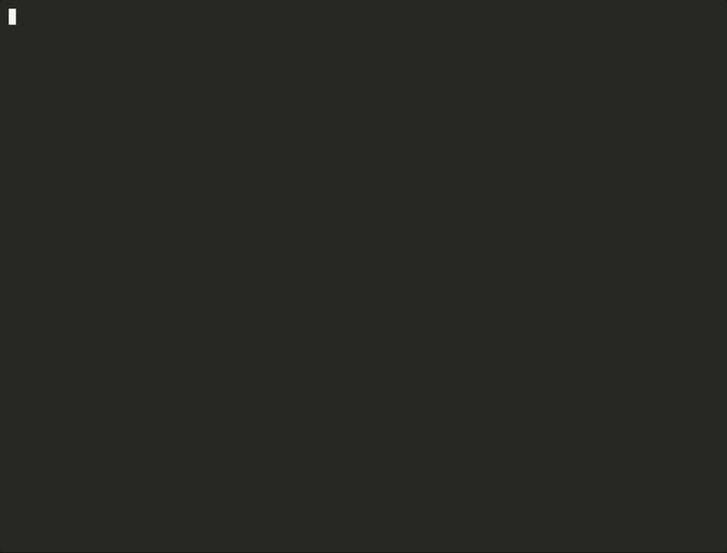

# MCP elicitation demo

A small, runnable demo of [MCP elicitation](https://modelcontextprotocol.io/specification/2026-07-28/client/elicitation)
on the **2026-07-28** spec. It covers both modes, plus all three ways a user can answer (accept, decline, cancel):

| Mode | Tool | What the server asks for | Why this mode |
| --- | --- | --- | --- |
| **Form** | `plan_trip` | Dates, nights, travelers, cabin, extras, email | Ordinary details the client may see, collected from a flat JSON Schema |
| **URL** | `checkout` | Card payment on a hosted page | Card data must **never** pass through the MCP client |



## Run it

You need Docker. Everything runs from Docker Compose.

```sh
docker compose up --build -d      # MCP server + payment page on http://localhost:3000
docker compose run --rm client    # interactive terminal client
```

The client opens a menu. Pick **Plan a trip**, fill in the form, then **Check out**. When the client prints
the payment link, open it in your browser and press **Pay** (or **Cancel**). Choose **Show protocol messages**
in the menu, or start the client with `SHOW_PROTOCOL=1 docker compose run --rm client`, to see every JSON-RPC round.

Stop everything with `docker compose down`.

**Without Docker** (Node 22+): `npm install`, then `npm run dev:server` in one terminal and `npm run dev:client`
in another.

For presenting, see the [5-minute run sheet](docs/run-sheet.md). If the live demo fails, there's a recording
in [`docs/demo.mp4`](docs/demo.mp4) (or `asciinema play docs/demo.cast`).

## How elicitation works on 2026-07-28

This spec revision replaced server-to-client requests with **multi round-trip requests (MRTR)**. The server
no longer sends `elicitation/create` while it holds the tool call open. Instead it *answers* the tool call with
`input_required`, and the client retries:

```text
client                                   server
  │ tools/call plan_trip {destination}      │
  │────────────────────────────────────────▶│ needs details
  │   resultType: input_required            │
  │   inputRequests.trip_details =          │
  │     elicitation/create (mode: form)     │
  │◀────────────────────────────────────────│
  │ user fills in the form                  │
  │ tools/call plan_trip (new request id)   │
  │   inputResponses.trip_details =         │
  │     { action: accept, content: {...} }  │
  │────────────────────────────────────────▶│ validates, prices
  │   result: Quote Q-1A2B3C, €1210         │
  │◀────────────────────────────────────────│
```

URL mode uses the same loop, plus an opaque `requestState` that the client must echo back unchanged:

1. `checkout` returns `input_required` with an `elicitation/create` in **URL mode** (`url: http://localhost:3000/pay/<uuid>`)
   and a signed `requestState` that records which payment session this is.
2. The client shows the full URL with the host highlighted and asks for consent. It never fetches the link itself.
3. On **accept** the user pays in the browser, and the card form posts straight to the server. The client retries
   the call with `{ action: "accept" }` and the same `requestState`.
4. The server reads the state, waits for the payment page to report back, and returns the booking. If the payment
   is still pending after 60 seconds, it returns `input_required` again with only `requestState`, and the client
   offers to check again.

**Accept** only means "the user agreed to open the link". The server learns the outcome from its own records,
never from the client.

### Accept, decline, cancel

| Action | Meaning | Form mode (`plan_trip`) | URL mode (`checkout`) |
| --- | --- | --- | --- |
| `accept` | User submitted / agreed | Validates and returns a quote. Re-asks if the data is invalid | Waits for the page, then books, or reports a cancel on the page |
| `decline` | User explicitly said no | "You declined to share trip details" | "Payment declined. Quote still on hold" |
| `cancel` | User dismissed it (Esc, Ctrl+C) | "Dismissed, ask again whenever" | "Checkout dismissed. Nothing charged" |

## What to look at in the code

| File | Shows |
| --- | --- |
| [`src/server/tools/planTrip.ts`](src/server/tools/planTrip.ts) | `inputRequired.elicit`, the restricted schema (date, integer range, titled enum, multi-select, email), server-side re-validation with `acceptedContent` |
| [`src/server/tools/checkout.ts`](src/server/tools/checkout.ts) | `inputRequired.elicitUrl`, signed `requestState`, waiting for out-of-band completion, capability check |
| [`src/server/app.ts`](src/server/app.ts) | `createRequestStateCodec` (HMAC, TTL, binding), stateless `createMcpHandler`, Host header validation, payment routes |
| [`src/client/flow.ts`](src/client/flow.ts) | The client side of the MRTR loop: answer `inputRequests`, retry with `inputResponses` and the exact `requestState` |
| [`src/client/terminalUi.ts`](src/client/terminalUi.ts) | Required client UX: which server is asking, review before sending, decline and cancel everywhere, URL consent |
| [`src/client/url.ts`](src/client/url.ts) | URL review: full link, highlighted host, warnings for non-HTTPS, Punycode, odd schemes |

Built with the TypeScript SDK v2 (`@modelcontextprotocol/server` and `@modelcontextprotocol/client` 2.4.0).

## Security notes (and demo shortcuts)

What the demo does, following the spec:

- No sensitive data in form mode. Card details only ever go to the payment page (URL mode).
- The server re-validates every accepted form answer. It treats client input as untrusted.
- `requestState` is HMAC-signed, expires after 15 minutes, and is bound to the method, so a tampered state is rejected.
- Payment URLs carry only an unguessable session id: no user data and nothing pre-authenticated.
- The server never sends a mode the client didn't declare. A form-only client gets a clear error from `checkout`.
- `/mcp` checks the Host header to block DNS rebinding.

What a production server must add:

- **Real user identity.** Use MCP authorization, and bind `requestState` and the payment session to the user's `sub`.
- **Phishing protection on the URL page.** The page must check that the person who opens it is the same user who
  started the checkout (for example with a session cookie). Otherwise a shared link could be completed by someone
  else, which is the account-takeover risk the spec describes.
- HTTPS everywhere, persistent storage, and a shared `STATE_SECRET` across instances.

## Development

```sh
npm install
npm test           # 24 tests: server, client flow and helpers, over real HTTP
npm run typecheck
npm run smoke      # end-to-end check against a running server (used in CI)
```

CI (GitHub Actions) runs typecheck, tests and build, then brings the stack up with Docker Compose and runs the smoke test.

To re-record the demo: start the server, then run `python3 scripts/record-demo.py`. This writes `docs/demo.cast`.
